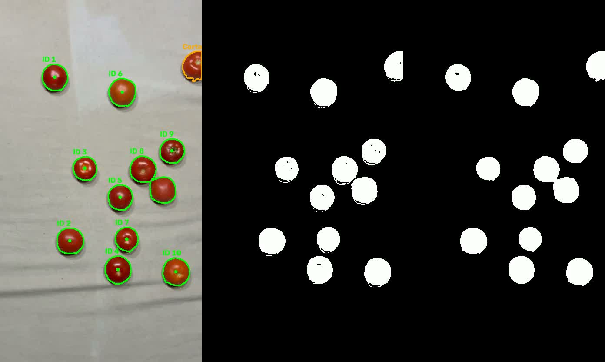
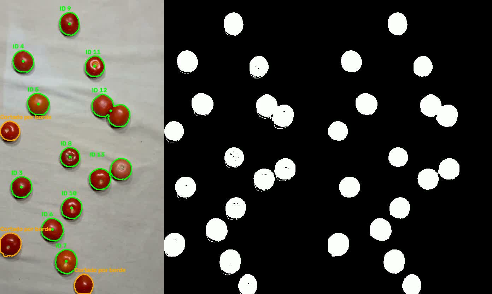

# Pruebas del flujo de video para el Hito 2

Revisión del 6 de noviembre de 2026 sobre la rama local `tom`, basada en
`637c150`, con los cambios de integración descritos en este registro.
Se consultaron `origin/main` y `origin/vicferx/tracking-base-y-contrato`.
La prueba abarca adquisición, segmentación, seguimiento, visualización guardada y
finalización del archivo. La ejecución de la interfaz, atributos y CSV sigue
bloqueada por módulos ausentes.

## Material y configuración

Se usaron los cinco MP4 de `Proyecto/VIDEOS/`, de 464 × 832 píxeles a 30 FPS.
Los JSON de [evidencias_video](evidencias_video/) contienen el SHA-256 de cada entrada
para identificar exactamente el material procesado.

Entorno de prueba Linux, Python 3.14.10, paquete `opencv-python==5.0.0.93`
y `numpy==2.5.4`. OpenCV informa internamente la versión 5.0.0.
Se utilizó un venv temporal en `/tmp/tel328-video-venv`. El README explica
cómo crear el entorno del equipo en Windows y Linux. Windows queda pendiente de prueba.

Se conservaron los parámetros existentes de los autores de segmentación y seguimiento.
HSV mínimo (0, 70, 50), máximo (179, 255, 255), elemento elíptico de 5 × 5,
apertura seguida de cierre, área mínima de contorno de 500 px² y tolerancia de borde
de 2 píxeles. Ambos seguidores usan distancia máxima de 80 píxeles y tolerancia
de 10 cuadros desaparecidos. Kalman usa ruido de proceso 0.01 y de medición 0.1.

## Reproducción

Desde la raíz de Agrovision, activar el venv e instalar las dependencias del README.
Para probar un clip:

```bash
python main_test.py "../VIDEOS/tomates_sabana_gris_1.mp4" --tracker centroide --sin-ventanas --salida-video salidas/hito2/centroide/tomates_sabana_gris_1.mp4 --resumen salidas/hito2/centroide/resumen.json
```

Cambiar el nombre por los clips 2 a 5 y repetir con `--tracker kalman`, guardando
en una carpeta distinta. Para reproducir el lote en Bash:

```bash
for tracker in centroide kalman; do
  for input in ../VIDEOS/*.mp4; do
    name=$(basename "$input" .mp4)
    python main_test.py "$input" --tracker "$tracker" --sin-ventanas --salida-video "salidas/hito2/$tracker/$name.mp4" --resumen "salidas/hito2/$tracker/$name.json" || break 2
  done
done
```

El panel muestra detecciones, máscara inicial y máscara limpia en ese orden.
Los originales están fuera de este repositorio. Para compartir la prueba con el profesor,
adjuntar los cinco originales y los MP4 generados o dar acceso a una carpeta compartida.
Los resúmenes JSON y dos capturas están en esta carpeta de documentación.

## Resultados de ejecución

Las diez ejecuciones terminaron con código 0 y estado FIN_DE_ARCHIVO.
Se verificó con ffprobe que cada MP4 generado tiene tantos cuadros como procesó el flujo.

| Clip | Cuadros por ejecución | IDs centroides | IDs Kalman | Máximo de detecciones seguidas simultáneas |
|---|---:|---:|---:|---:|
| 1 | 421 | 16 | 16 | 13 |
| 2 | 407 | 16 | 16 | 13 |
| 3 | 348 | 18 | 18 | 13 |
| 4 | 275 | 15 | 15 | 15 |
| 5 | 387 | 16 | 16 | 15 |

Son 1.838 cuadros por seguidor y 3.676 cuadros procesados entre las diez ejecuciones.
Los IDs asignados cuentan altas del seguidor. Su correspondencia con el número real
de frutos y los cambios de identidad requiere anotación manual.
La igualdad de totales entre seguidores tampoco demuestra igualdad de trayectorias
ni una ventaja de Kalman. Se revisaron las capturas indicadas abajo, sin auditar
visualmente cada fotograma de los diez videos.

## Incidencias y correcciones

| Hallazgo | Acción realizada | Verificación o pendiente |
|---|---|---|
| El flujo básico solo permitía observar video mediante ventanas | Se agregó salida MP4, modo sin ventanas, selección del seguidor existente y resumen JSON | Los cinco clips terminaron con ambos seguidores y conservaron el número de cuadros en la salida |
| La interfaz importaba evaluación y anotación desde main_test, donde esas funciones no existen | Se corrigió la referencia a main_test2 | Verificado por lectura y sintaxis. La prueba completa de interfaz sigue bloqueada |
| main_test2 fallaba incluso al pedir ayuda por imports de módulos ausentes | Se difirió la carga de atributos y registro hasta después de leer los argumentos y se agregó un mensaje de dependencia faltante | La ayuda funciona. La ejecución identifica funciones.madurez y termina con código 1 |
| README anunciaba opciones CSV de main_test2 bajo main_test | Se corrigieron instrucciones y estado de disponibilidad | Los comandos del flujo básico se ejecutaron |
| Riesgo de incluir venv y videos generados al preparar cambios | Se agregaron .venv/ y salidas/ a .gitignore | Las salidas permanecen locales |
| Los módulos madurez, manchas y registro están ausentes de ambas ramas remotas consultadas | Se identificaron las tres dependencias requeridas | Sus responsables deben aportar las implementaciones para cerrar integración de atributos, CSV y dashboard |

La foto summerlast.png sigue generando las tres vistas. Un archivo de video inexistente
termina con código 1 e informa PERDIDA_DE_SEÑAL mediante el estado PERDIDA_DE_SENAL.
No se probó desconexión de cámara ni recuperación de señal.

## Observaciones

En el clip 1 a los 6 segundos aparecen tomates próximos que forman un único contorno
en la máscara limpia. En el clip 3 a los 6 segundos, dos tomates próximos ya están unidos
en la máscara inicial y siguen unidos después de la morfología. Esto puede modificar
el centroide que recibe el seguidor. Se pueden usar estos fotogramas
para estudiar segmentación y asociación respectivamente.





Hay frutos marcados como cortados por el borde. Esa decisión depende de la caja
del contorno segmentado y debe contrastarse con la imagen original, especialmente
cuando una zona poco saturada del fruto desaparece de la máscara.

La calibración actual define una ROI para otra geometría y una escala de referencia.
Estas pruebas no convierten tamaños a milímetros ni evalúan madurez, manchas o peso.
La validación de esos parámetros requiere el montaje y sus referencias físicas.

## Evidencia para la bitácora

Registrar la ejecución de los cinco clips con ambos seguidores,
las correcciones de integración, la comprobación del número de cuadros de salida y
este registro. Agregar el enlace al commit cuando se autorice y el enlace accesible
a los videos originales y procesados cuando se compartan.

La interfaz, el CSV, los atributos y la estabilidad de identidad contra una referencia
manual quedan pendientes. La integración documentada cubre el flujo básico de video.
