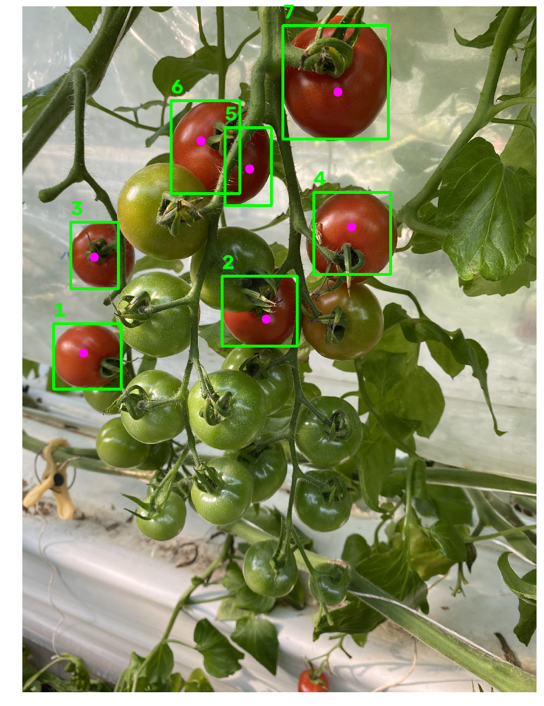
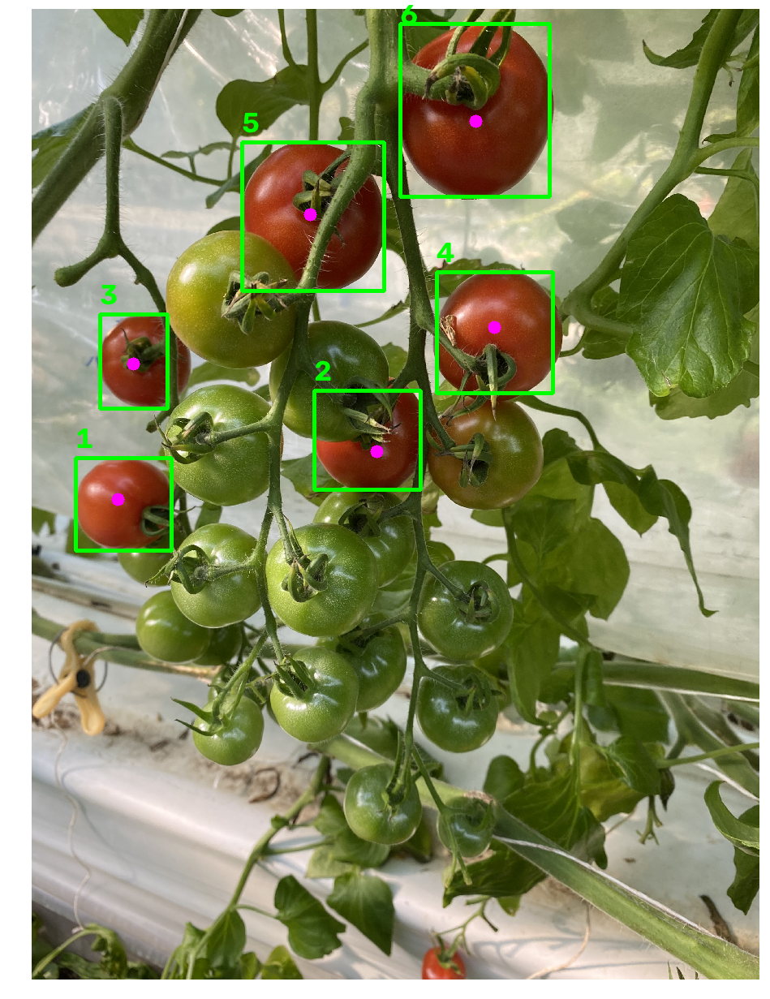

# Segmentación de tomates (A2.3) — código y evidencia de funcionamiento

Este documento junta todo lo relacionado específicamente con la **segmentación**: qué hace el código, por qué está hecho así, y la evidencia de que funciona (y de cuándo no, y cómo se corrigió).

## Índice
1. [`funciones/seg.py` — una sola clase, color solo o color + fondo](#1-funcionessegpy--una-sola-clase-color-solo-o-color--fondo)
2. [Evidencia 1: foto propia del repo (un tomate)](#2-evidencia-1-foto-propia-del-repo-un-tomate)
3. [Evidencia 2: foto real con varios tomates (IDs por instancia)](#3-evidencia-2-foto-real-con-varios-tomates-ids-por-instancia)
4. [Evidencia 3: por qué el color solo no alcanza para fruta de cualquier color](#4-evidencia-3-por-qué-el-color-solo-no-alcanza-para-fruta-de-cualquier-color)
5. [Evidencia 4: corregir blobs mal formados — un tallo que parte una fruta en dos, y frutas que se tocan](#5-evidencia-4-corregir-blobs-mal-formados--un-tallo-que-parte-una-fruta-en-dos-y-frutas-que-se-tocan)
6. [Evidencia 5: video real — ambos métodos, 14/15 vs 15/15](#6-evidencia-5-video-real--ambos-métodos-14-15-vs-15-15)
7. [Evidencia 6: persistencia del ID entre cuadros (segmentación → tracking)](#7-evidencia-6-persistencia-del-id-entre-cuadros-segmentación--tracking)
8. [Qué falta / próximos pasos](#8-qué-falta--próximos-pasos)

---

## 1. `funciones/seg.py` — una sola clase, color solo o color + fondo

Una única clase, `ClassicSegmenter`, recibe un cuadro BGR y devuelve `(mask, instances)`, donde `instances` es una lista (una por tomate detectado) de diccionarios con `bbox`, `centroid`, `area_px`, `contour` e `is_valid_mask`. (Hasta una versión anterior de este documento existían dos clases separadas, `ClassicSegmenter` y `BackgroundColorSegmenter` en un archivo `seg_fondo.py` — se unificaron en una sola porque hacían casi lo mismo.)

```python
raw_mask = mascara_color(frame)                          # 1 = color de tomate
if fondo_referencia is not None:
    raw_mask = raw_mask AND mascara_fondo(frame)         # + distinto al fondo vacío (opcional)

clean_mask = cv2.morphologyEx(raw_mask, cv2.MORPH_OPEN, kernel_apertura)  # saca ruido suelto
clean_mask = cv2.morphologyEx(clean_mask, cv2.MORPH_CLOSE, kernel_cierre) # rellena huecos (tallo, reflejos)
contours, _ = cv2.findContours(clean_mask, cv2.RETR_EXTERNAL, cv2.CHAIN_APPROX_SIMPLE)
if separar_contacto:
    contours = separar_con_watershed(clean_mask, frame)  # opcional: separa blobs que se tocan
```
donde `mascara_color` es `cv2.inRange` en HSV (uno o varios rangos combinados con `OR`, vía `rangos_extra`) y `mascara_fondo` es `cv2.absdiff(frame, fondo_referencia)` umbralizado.

Por cada contorno con área ≥ `min_area_px`: `cv2.boundingRect` da la caja, `cv2.moments` da el centroide, y se marca `is_valid_mask=False` si la caja toca el borde del cuadro (para no falsear el calibre con un tomate cortado).

**Parámetros opcionales del constructor** (todos apagados/neutros por defecto, se activan según lo que necesite la foto o video):

| Parámetro | Para qué sirve | Cuándo usarlo |
|---|---|---|
| `fondo_referencia` | Exige además que el píxel sea distinto a una foto del fondo vacío. Permite un rango de color mucho más amplio sin falsos positivos. | Hay una foto de referencia del fondo vacío (misma cámara/iluminación). |
| `rangos_extra` | Agrega más rangos HSV combinados con `OR` al principal. | Hay que detectar más de un color de fruta a la vez. |
| `kernel_size_cierre` | Tamaño del kernel de **cierre** (rellenar huecos), por separado del de **apertura** (`kernel_size`, que solo saca ruido). | Un tallo/rama corta visualmente una fruta en dos — ver sección 5. Agrandar solo este, no los dos, porque agrandar también la apertura erosiona el contorno real de la fruta. |
| `separar_contacto` + `ajuste_pico` | Activa Watershed para partir en dos (o más) un blob que en realidad son dos frutas tocándose. | Dos frutas distintas que se tocan terminan con un solo contorno (un solo centroide, área doble) — ver sección 5. |

En todos los modos el resultado tiene el mismo formato — el resto del pipeline (`track.py`, `calib.py`, `madurez.py`, `manchas.py`, `registro.py`) no necesita saber cuáles de estas opciones están activas.

---

## 2. Evidencia 1: foto propia del repo (un tomate)

Imagen: `dataset/fotos/summerlast.png` (la única foto que había en el repo al momento de esta prueba).

| Original | Máscara cruda | Máscara limpia | Resultado anotado |
|---|---|---|---|
|  |  |  |  |

Resultado: 1 tomate detectado, `bbox=(209,25,276,335)`, `centroide=(343,202)`, `area_px=58675`, `is_valid_mask=True`. Confirma que el pipeline básico (HSV → morfología → contornos → bbox/centroide) corre sin errores sobre una imagen real del propio repositorio.

## 3. Evidencia 2: foto real con varios tomates (IDs por instancia)

Imagen real (no sintética) de tomates en planta, del set de ejemplos público de Laboro Tomato (repositorio `laboroai/LaboroTomatoDatasets`, CC BY-NC-SA 4.0 — ver `modelo/README.md`).

| Original | Resultado con ID por tomate (antes de la corrección de la sección 5) |
|---|---|
|  |  |

Parámetros: `hsv_lower=(0,70,40)`, `hsv_upper=(10,255,255)` (rojo maduro), `kernel_size=9` (apertura y cierre iguales), `min_area_px=1500`. Con estos parámetros salen **7 instancias**. Los tomates verdes de la misma foto no entran — ver sección 4, es intencional y tiene una razón de fondo.

**Corrección importante sobre esta misma imagen:** de esas 7 instancias, las etiquetadas 5 y 6 en la imagen de arriba **no son dos tomates distintos** — son **un solo tomate** cuyo contorno quedó partido en dos porque un tallo lo cruza por delante y rompe la máscara de color justo ahí. Esto se detectó al revisar la imagen con detalle y se corrige en la sección 5 (es un bug real del resultado, no solo una forma distinta de describirlo).

**Importante — el "ID" que se ve en esta imagen no es un ID de seguimiento:** es solo el orden en que `seg.py` devolvió la lista de instancias para ESTE cuadro. El ID que persiste entre cuadros lo asigna `track.py`/`track_kalman.py`, no `seg.py` — ver sección 7 para la demostración de esa diferencia.

## 4. Evidencia 3: por qué el color solo no alcanza para fruta de cualquier color

Intento de ampliar `seg.py` con un segundo rango HSV para detectar también los tomates verdes de la foto anterior:


Resultado: casi toda la foto se marca como "tomate" — porque un tomate verde y una hoja tienen el mismo color. Esto **no es un umbral mal puesto**, es un límite real de segmentar solo por color cuando el fondo comparte el color del objeto. De ahí nace la opción `fondo_referencia` de `ClassicSegmenter` (sección 1): si hay una foto del fondo vacío, se puede exigir color Y distinto-al-fondo a la vez, así un rango amplio (que cubra verde y rojo) no se come toda la foto.

## 5. Evidencia 4: corregir blobs mal formados — un tallo que parte una fruta en dos, y frutas que se tocan

La sección 3 mostró un problema real sobre una foto real: un tallo cruzando por delante de un tomate partió su máscara en dos piezas, que `cv2.findContours` entrega como dos contornos separados (dos "IDs" para una sola fruta). Hay también el problema inverso: dos frutas distintas que se tocan físicamente pueden quedar fusionadas en un solo contorno (un solo centroide, área del doble). Son dos fallas opuestas de la misma etapa (contornos sobre una máscara binaria) y `seg.py` las corrige con dos herramientas distintas.

### 5.1 Tallo que parte una fruta en dos — corregido con un cierre más grande

**Intento fallido primero:** agrandar el kernel de apertura y de cierre juntos (`kernel_size=29` para ambos) sí junta las dos piezas del tomate partido, pero **erosiona el contorno de otros tomates** de la misma foto (una caja llegó a perder un tercio de su alto). No sirve: soluciona un problema creando otro.

**Fix correcto:** separar el kernel de **apertura** (saca ruido, se deja chico, `kernel_size=9`) del de **cierre** (rellena huecos/puentea el tallo, se agranda solo él, `kernel_size_cierre=21`). Esto es exactamente el parámetro `kernel_size_cierre` descrito en la sección 1.

| | Apertura | Cierre | Instancias | ¿Qué pasa con el tomate partido? |
|---|---|---|---|---|
| **Antes** | 9 | 9 (igual) | 7 | Queda partido en 2 (cajas `(392,222,81,136)` área 5666 y `(298,175,120,162)` área 9650) |
| **Después** | 9 | **21** | **6** | Se une en **una sola instancia**: caja `(298,175,175,183)`, área 15636 |

| Antes (7 instancias, tomate partido) | Después (6 instancias, tomate unido) |
|---|---|
|  |  |

**Verificación de que no se dañó nada más:** de las otras 5 frutas de la foto, 3 prácticamente no cambiaron de área (+0.3%, +1.7%, +1.2% — ruido de redondeo del cierre más grande), y 2 crecieron un poco más (+18.6% y +12.5%) porque el cierre más grande también alcanzó a rellenar huecos reales más chicos en esas mismas frutas (un reflejo o la sombra de una hoja); siguen siendo una sola instancia cada una, no se fusionaron con su vecina. El conteo bajó de 7 a 6 — exactamente una fusión, la correcta, confirmando que `kernel_size_cierre=21` resuelve este caso puntual sin generar fusiones de más.

### 5.2 Frutas que sí son dos y se tocan — separadas con Watershed

El caso contrario: dos frutas reales, distintas, que se tocan y deben quedar como dos instancias. `separar_contacto=True` activa un paso extra: calcula la distancia de cada píxel de la máscara al borde más cercano (`cv2.distanceTransform`). El centro de una fruta está lejos de cualquier borde (distancia alta); el punto donde dos frutas se tocan está cerca de un borde por ambos lados (distancia baja). Eso separa la máscara en "centros seguros" (picos de distancia) y usa `cv2.watershed` para cortar justo en el valle entre dos centros pegados.

Para calibrar el parámetro `ajuste_pico` (qué tan "profundo" tiene que ser ese valle para cortar) se necesita un caso con **ground truth conocido** — saber con certeza que son exactamente 2 objetos y en qué cuadro exacto se tocan por primera vez. Eso es difícil de garantizar con fruta real revisando a ojo, así que esta calibración puntual se hizo con un video sintético de control (dos círculos que se acercan y se tocan, `dataset/videos/sintetico_oclusion.mp4`) — es la única prueba de este documento que no usa una imagen real, y es solo para encontrar el número correcto del parámetro, no para demostrar que el código funciona (eso ya quedó demostrado arriba, con fruta real).

| Cuadro | Situación | Sin `separar_contacto` | Con `separar_contacto=True` |
|---|---|---|---|
| #25 | Los dos círculos recién se tocan (silueta con forma de "8") |  1 instancia |  **2 instancias correctas** |
| #28 | Un círculo pasa casi exactamente por delante del otro (solapamiento casi total) | 1 instancia |  **sigue siendo 1 — no se pudo separar** |

Se probó `ajuste_pico` con 0.3, 0.35, 0.4, 0.45 y 0.5: **0.4** es el valor donde el cuello entre los dos círculos recién tocándose queda por debajo del umbral (se separan) sin cortar de más una fruta sana.

**Por qué el cuadro #28 no se pudo arreglar, y por qué eso es correcto (no un bug):** cuando un objeto está casi exactamente delante del otro, la silueta 2D que ve la cámara es prácticamente idéntica a la de un solo objeto — no hay "valle" en la distancia al borde porque, geométricamente, no hay información suficiente en una sola imagen para saber que son dos. Esto es una oclusión real, no un problema de la máscara, y es justamente el caso para el que existe `track_kalman.py`: en vez de intentar separar el blob en ese cuadro, el filtro de Kalman sigue prediciendo la posición de la fruta tapada usando su velocidad, y cuando vuelve a verse por separado unos cuadros después, la reconecta con su ID (ver `docs/adaptacion.md`, fila de `track_kalman.py`).

### 5.3 Resumen: dos arreglos para dos fallas opuestas

| Falla | Síntoma | Arreglo | Parámetro |
|---|---|---|---|
| Un tallo/rama parte UNA fruta en dos piezas | De menos instancias a más de las que hay (sobra un ID) | Agrandar solo el **cierre** (rellena el hueco del tallo) | `kernel_size_cierre` |
| Dos frutas se tocan y se fusionan en un blob | De más instancias a menos de las que hay (falta un ID) | **Watershed** (corta en el valle entre dos centros) | `separar_contacto`, `ajuste_pico` |

Ambos son parte de la misma clase `ClassicSegmenter` y se pueden usar juntos (primero se limpia/cierra la máscara, después se separan los blobs que sigan tocándose) — el resto del pipeline (`track.py` en adelante) no necesita saber cuál de los dos se usó, porque el contrato de salida (`bbox`/`centroid`/`area_px`/`contour`/`is_valid_mask`) es el mismo.

## 6. Evidencia 5: video real — ambos métodos, 14/15 vs 15/15

Video real del equipo: `dataset/videos/tomates_sabana_gris_2.mp4`, cuadro #200 (15 tomates cherry reales sobre tela clara, celular a pulso).

| Método original (`ClassicSegmenter`, color rojo estricto) | Método combinado (color amplio + `fondo_referencia`) |
|---|---|
|  |  |
| **14 de 15** — el tomate anaranjado queda fuera del rango "rojo puro" | **15 de 15** — al combinar con fondo, el filtro de color puede ser amplio (detecta cualquier tono) sin agregar falsos positivos, porque el fondo ya descarta todo lo que no cambió |

Detalle completo de esta prueba (parámetros, diferencia de fondo, recomendación de grabar la tela vacía con cámara fija) en `docs/adaptacion.md`, sección 4.

## 7. Evidencia 6: persistencia del ID entre cuadros (segmentación → tracking)

Mismo video (`tomates_sabana_gris_2.mp4`), usando `ClassicSegmenter` + `track.py` (`CentroidTracker`). Se siguió el mismo video entre los cuadros 0 y 120 y se registró qué ID de tracking tenía cada tomate en cada cuadro.

El tomate marcado en **rojo** es el mismo en los 3 cuadros — nótese que se desplaza en la imagen (por el paneo de la cámara, los tomates en sí no se mueven) pero conserva **ID 1** todo el tiempo:

| Cuadro #20 | Cuadro #60 | Cuadro #100 |
|---|---|---|
|  |  |  |

Centroide del tomate ID 1 en cada cuadro — el desplazamiento es gradual y consistente, no un salto (lo que confirmaría que es el mismo objeto, no una reasignación casual del número):

| Cuadro | Centroide (x, y) |
|---|---|
| 20 | (372, 700) |
| 60 | (364, 696) |
| 100 | (320, 692) |

Los IDs 2, 3 y 5 también se mantuvieron estables los 120 cuadros. Algunos IDs aparecen y desaparecen (4, 6, 7, 8...) — son tomates que entran/salen del cuadro por el paneo, o ruido puntual de un reflejo; es un comportamiento esperado del tracker, no un error.

**Por qué importa esto para el resto del pipeline:** `seg.py` entrega la lista de instancias *sin* ID persistente — es `track.py`/`track_kalman.py` quien lo agrega, comparando centroides entre cuadros consecutivos. Una vez que el tomate tiene un ID estable, `main_test.py` arma su máscara individual y le calcula calibre/madurez/manchas por separado (nunca se mezcla con el tomate vecino), y `registro.py` guarda una sola fila por ID en el CSV — el mismo formato que después lee `interfaz/dashboard.py`.

## 8. Qué falta / próximos pasos

- ~~**Fusión de blobs que se tocan**~~ — **resuelto con Watershed, sección 5.2.**
- ~~**Un tallo parte una fruta en dos**~~ — **resuelto agrandando solo el cierre (`kernel_size_cierre`), sección 5.1.**
- **Sustracción de fondo con cámara fija:** las pruebas de video real se hicieron con un cuadro cualquiera del mismo video como referencia de fondo (no había una toma vacía). Funciona, pero con margen ajustado. Recomendación: grabar unos segundos de la tela/cinta vacía con la cámara fija antes de poner la fruta.
- **Reconocimiento de especie (OE4):** hoy el color/rango hay que ajustarlo a mano por especie. La idea de diseño es que el modelo entrenado (`modelo/`) reconozca la especie y el sistema elija automáticamente el perfil de parámetros (color, calibración, madurez) correspondiente — ver `modelo/README.md`.
