# Segmentación de tomates — código y evidencia de funcionamiento

Este documento junta todo lo relacionado específicamente con la **segmentación**: qué hace el código, por qué está hecho así, y la evidencia de que funciona (y de cuándo no).

## Índice
1. [`funciones/seg.py` — una sola clase, color solo o color + fondo](#1-funcionessegpy--una-sola-clase-color-solo-o-color--fondo)
3. [Evidencia 1: foto propia del repo (un tomate)](#3-evidencia-1-foto-propia-del-repo-un-tomate)
4. [Evidencia 2: foto real con varios tomates (IDs por instancia)](#4-evidencia-2-foto-real-con-varios-tomates-ids-por-instancia)
5. [Evidencia 3: por qué el color solo no alcanza para fruta de cualquier color](#5-evidencia-3-por-qué-el-color-solo-no-alcanza-para-fruta-de-cualquier-color)
6. [Evidencia 4: fondo + color combinados (escena sintética controlada)](#6-evidencia-4-fondo--color-combinados-escena-sintética-controlada)
7. [Evidencia 5: video real — ambos métodos, 14/15 vs 15/15](#7-evidencia-5-video-real--ambos-métodos-14-15-vs-15-15)
8. [Evidencia 6: persistencia del ID entre cuadros (segmentación → tracking)](#8-evidencia-6-persistencia-del-id-entre-cuadros-segmentación--tracking)
9. [Qué falta / próximos pasos](#9-qué-falta--próximos-pasos)

---

## 1. `funciones/seg.py` — una sola clase, color solo o color + fondo

Una única clase, `ClassicSegmenter`, recibe un cuadro BGR y devuelve `(mask, instances)`, donde `instances` es una lista (una por tomate detectado) de diccionarios con `bbox`, `centroid`, `area_px`, `contour` e `is_valid_mask`. 

```python
raw_mask = mascara_color(frame)                          # 1 = color de tomate
if fondo_referencia is not None:
    raw_mask = raw_mask AND mascara_fondo(frame)         # + distinto al fondo vacío (opcional)

clean_mask = cv2.morphologyEx(raw_mask, cv2.MORPH_OPEN, kernel)   # saca ruido suelto
clean_mask = cv2.morphologyEx(clean_mask, cv2.MORPH_CLOSE, kernel) # rellena huecos (reflejos)
contours, _ = cv2.findContours(clean_mask, cv2.RETR_EXTERNAL, cv2.CHAIN_APPROX_SIMPLE)
```
donde `mascara_color` es `cv2.inRange` en HSV (uno o varios rangos combinados con `OR`, vía `rangos_extra`) y `mascara_fondo` es `cv2.absdiff(frame, fondo_referencia)` umbralizado.

Por cada contorno con área ≥ `min_area_px`: `cv2.boundingRect` da la caja, `cv2.moments` da el centroide, y se marca `is_valid_mask=False` si la caja toca el borde del cuadro (para no falsear el calibre con un tomate cortado).

**Dos modos de uso, según si se pasa `fondo_referencia` al constructor:**

| Modo | Cómo se llama | Cuándo usarlo |
|---|---|---|
| Solo color (por defecto) | `ClassicSegmenter(hsv_lower=..., hsv_upper=...)` | No hay foto del fondo vacío disponible, o el fondo no comparte color con ningún objeto que no sea fruta. |
| Color + fondo | `ClassicSegmenter(hsv_lower=..., hsv_upper=..., fondo_referencia=foto_vacia)` | Hay una foto de referencia del fondo vacío (misma cámara/iluminación). Permite usar un rango de color mucho más amplio (detecta fruta de cualquier tono) sin agregar falsos positivos, porque el fondo ya descarta todo lo que no cambió. |

En ambos modos el resultado tiene el mismo formato — el resto del pipeline (`track.py`, `calib.py`, `madurez.py`, `manchas.py`, `registro.py`) no necesita saber cuál de los dos modos se usó.

---

## 3. Evidencia 1: foto propia del repo (un tomate)

Imagen: `dataset/fotos/summerlast.png`.

| Original | Máscara cruda | Máscara limpia | Resultado anotado |
|---|---|---|---|
| 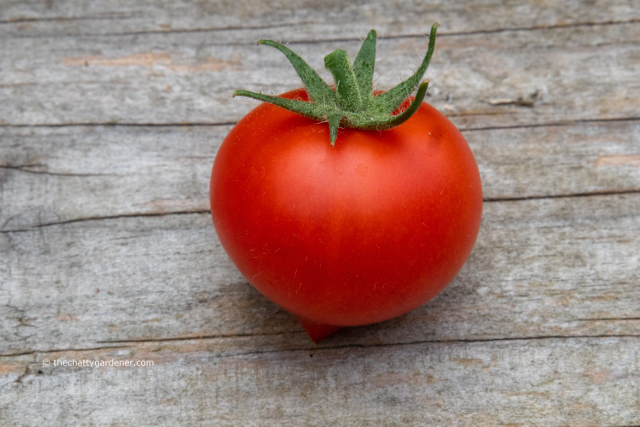 | 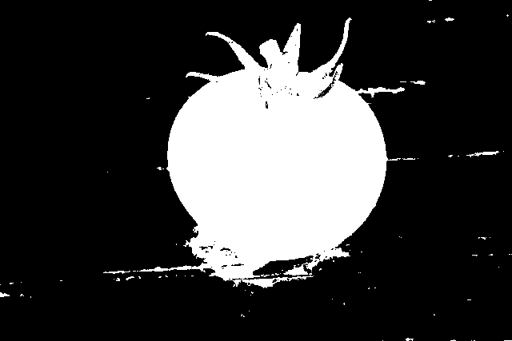 | 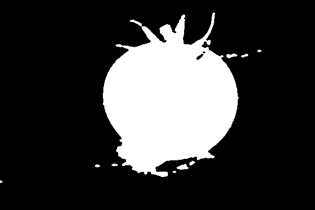 | 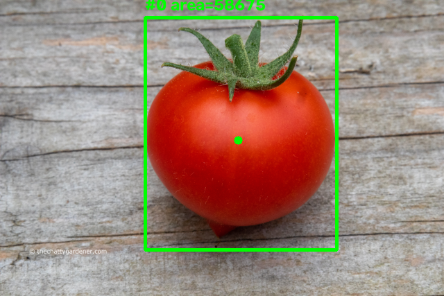 |

Resultado: 1 tomate detectado, `bbox=(209,25,276,335)`, `centroide=(343,202)`, `area_px=58675`, `is_valid_mask=True`. Confirma que el pipeline básico (HSV → morfología → contornos → bbox/centroide) corre sin errores sobre una imagen real del propio repositorio.

## 4. Evidencia 2: foto real con varios tomates (IDs por instancia)

Imagen real de tomates en planta, del set de ejemplos público de Laboro Tomato (repositorio `laboroai/LaboroTomatoDatasets`.

| Original | Resultado con ID por tomate |
|---|---|
| 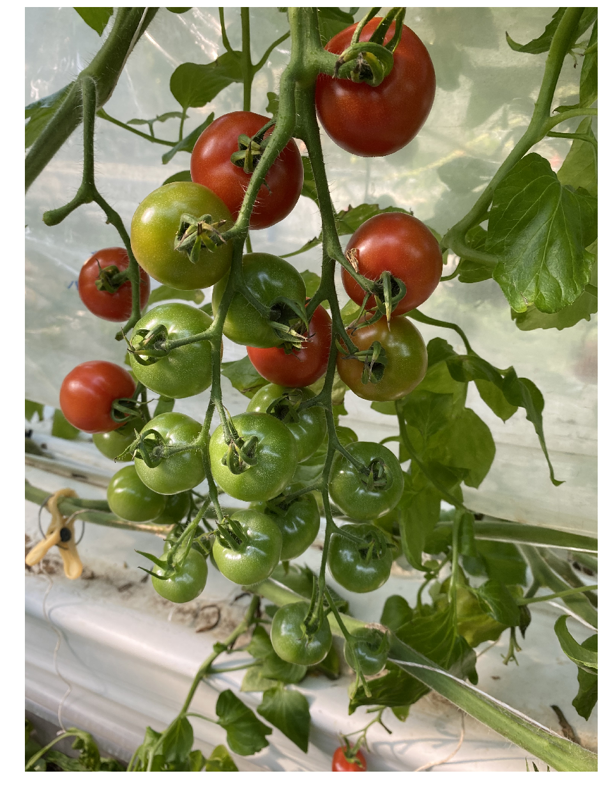 |  |

Parámetros: `hsv_lower=(0,70,40)`, `hsv_upper=(10,255,255)` (rojo maduro), `kernel_size=9`, `min_area_px=1500`. **7 tomates maduros detectados**, cada uno como instancia separada (ID 1 a 7 en orden de detección), con su propio `bbox`/`centroid`/`area_px`. Los tomates verdes de la misma foto no entran — ver sección 5, es intencional y tiene una razón de fondo.

**Importante — el "ID" que se ve en esta imagen no es un ID de seguimiento:** es solo el orden en que `seg.py` devolvió la lista de instancias para ESTE cuadro. El ID que persiste entre cuadros lo asigna `track.py`/`track_kalman.py`, no `seg.py` — ver sección 8 para la demostración de esa diferencia.

## 5. Evidencia 3: por qué el color solo no alcanza para fruta de cualquier color

Intento de ampliar `seg.py` con un segundo rango HSV para detectar también los tomates verdes de la foto anterior:

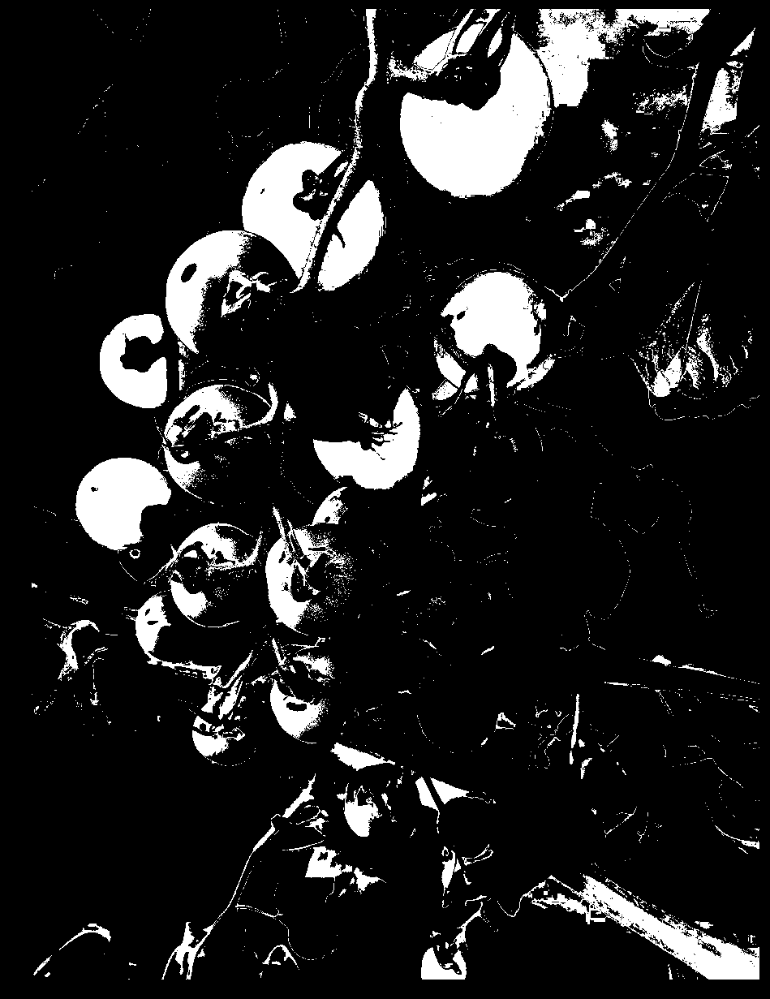

Resultado: casi toda la foto se marca como "tomate" — porque un tomate verde y una hoja tienen el mismo color. Esto **no es un umbral mal puesto**, es un límite real de segmentar solo por color cuando el fondo comparte el color del objeto. De ahí nace `seg_fondo.py` (sección 2).

## 6. Evidencia 4: fondo + color combinados (escena sintética controlada)

Para probar si fondo+color resuelve lo anterior, se armó una escena controlada: un tomate rojo, un tomate verde, una **mancha roja fija** pegada al fondo (no es fruta) y una **sombra** (no tiene color de fruta):

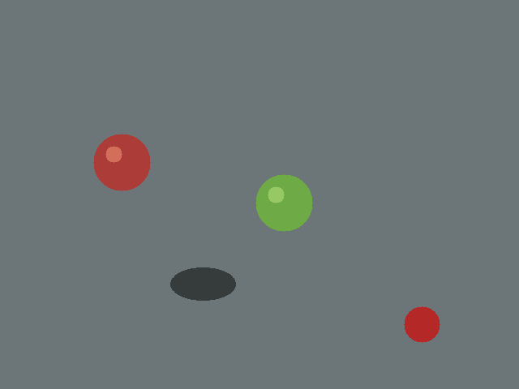

| Método | Resultado | Falla |
|---|---|---|
| Solo color | 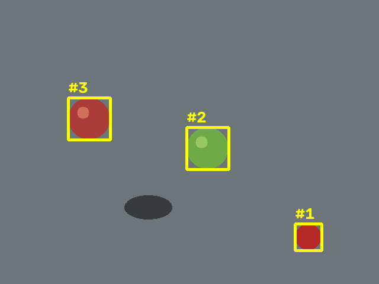 | marca la mancha fija como si fuera fruta |
| Solo fondo | 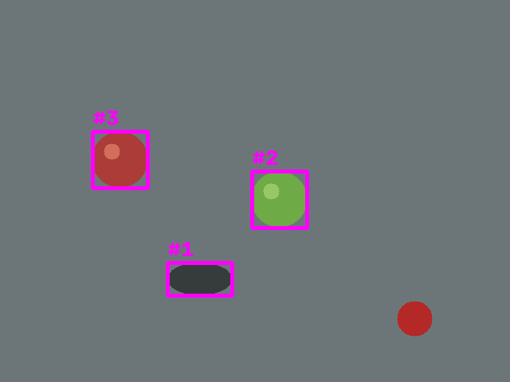 | marca la sombra como si fuera fruta |
| **Combinado (fondo AND color)** | 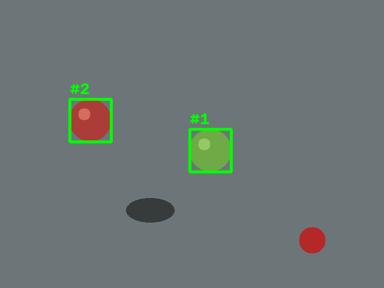 | **ninguna — detecta justo los 2 tomates** |

## 7. Evidencia 5: video real — ambos métodos, 14/15 vs 15/15

Video real del equipo: `dataset/videos/tomates_sabana_gris_2.mp4`, cuadro #200 (15 tomates cherry reales sobre tela clara, celular a pulso).

| Método original (`ClassicSegmenter`, color rojo estricto) | Método combinado (`BackgroundColorSegmenter`, color amplio) |
|---|---|
| 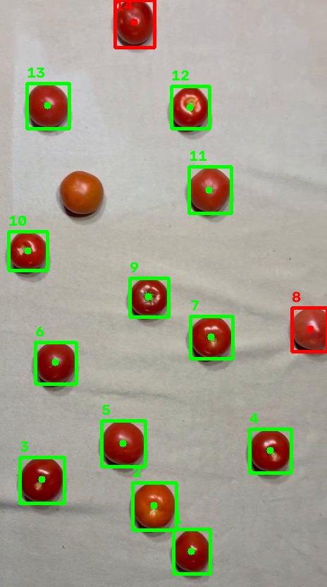 | 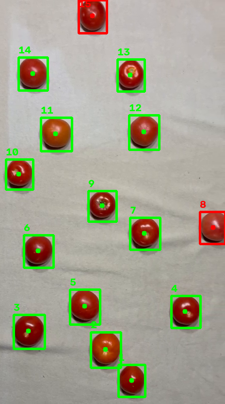 |
| **14 de 15** — el tomate anaranjado queda fuera del rango "rojo puro" | **15 de 15** — al combinar con fondo, el filtro de color puede ser amplio (detecta cualquier tono) sin agregar falsos positivos, porque el fondo ya descarta todo lo que no cambió |

Detalle completo de esta prueba (parámetros, diferencia de fondo, recomendación de grabar la tela vacía con cámara fija) en `docs/adaptacion.md`, sección 4.

## 8. Evidencia 6: persistencia del ID entre cuadros (segmentación → tracking)

Misma video (`tomates_sabana_gris_2.mp4`), usando `ClassicSegmenter` + `track.py` (`CentroidTracker`). Se siguió el mismo video entre los cuadros 0 y 120 y se registró qué ID de tracking tenía cada tomate en cada cuadro.

El tomate marcado en **rojo** es el mismo en los 3 cuadros — nótese que se desplaza en la imagen (por el paneo de la cámara, los tomates en sí no se mueven) pero conserva **ID 1** todo el tiempo:

| Cuadro #20 | Cuadro #60 | Cuadro #100 |
|---|---|---|
| 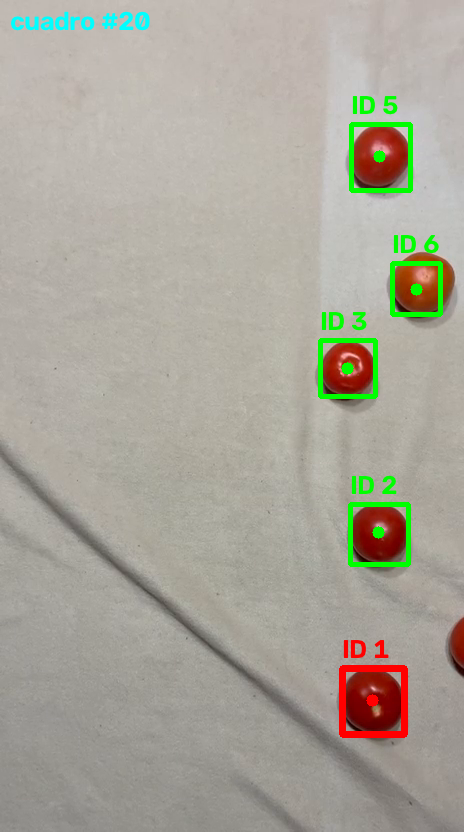 | 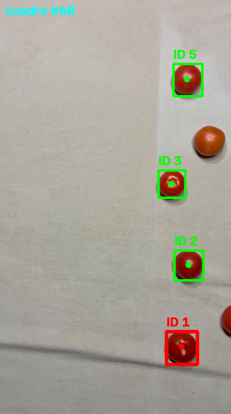 | 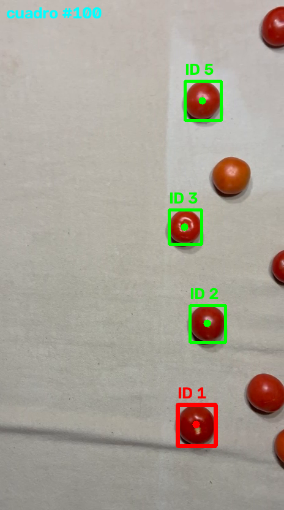 |

Centroide del tomate ID 1 en cada cuadro — el desplazamiento es gradual y consistente, no un salto (lo que confirmaría que es el mismo objeto, no una reasignación casual del número):

| Cuadro | Centroide (x, y) |
|---|---|
| 20 | (372, 700) |
| 60 | (364, 696) |
| 100 | (320, 692) |

Los IDs 2, 3 y 5 también se mantuvieron estables los 120 cuadros. Algunos IDs aparecen y desaparecen (4, 6, 7, 8...) — son tomates que entran/salen del cuadro por el paneo, o ruido puntual de un reflejo; es un comportamiento esperado del tracker, no un error.

**Por qué importa esto para el resto del pipeline:** `seg.py`/`seg_fondo.py` entregan la lista de instancias *sin* ID persistente — es `track.py`/`track_kalman.py` quien lo agrega, comparando centroides entre cuadros consecutivos. Una vez que el tomate tiene un ID estable, `main_test.py` arma su máscara individual y le calcula calibre/madurez/manchas por separado (nunca se mezcla con el tomate vecino), y `registro.py` guarda una sola fila por ID en el CSV — el mismo formato que después lee `interfaz/dashboard.py`.

## 9. Qué falta / próximos pasos

- ~~**Fusión de blobs que se tocan**~~ — **resuelto parcialmente con Watershed, ver sección 10.**
- **Sustracción de fondo con cámara fija:** las pruebas de video real se hicieron con un cuadro cualquiera del mismo video como referencia de fondo (no había una toma vacía). Funciona, pero con margen ajustado. Recomendación: grabar unos segundos de la tela/cinta vacía con la cámara fija antes de poner la fruta.
- **Reconocimiento de especie (OE4):** hoy el color/rango hay que ajustarlo a mano por especie. La idea de diseño es que el modelo entrenado (`modelo/`) reconozca la especie y el sistema elija automáticamente el perfil de parámetros (color, calibración, madurez) correspondiente — ver `modelo/README.md`.

## 10. Separación de blobs que se tocan (Watershed) — resultado de la prueba

`ClassicSegmenter(..., separar_contacto=True, ajuste_pico=0.4)` agrega un paso extra después de limpiar la máscara: en vez de aceptar cada región conectada como una sola instancia, calcula la **distancia de cada píxel al borde más cercano** (`cv2.distanceTransform`). El centro de un tomate está lejos de cualquier borde (distancia alta); el punto donde dos tomates se tocan está cerca de un borde por ambos lados (distancia baja). Eso separa la máscara en "centros seguros" (picos de distancia) y aplica `cv2.watershed` para cortar justo en el valle entre dos centros que están pegados.

**Prueba con el video sintético de dos círculos que se tocan y se separan (`dataset/videos/sintetico_oclusion.mp4`):**

| Cuadro | Situación | Sin `separar_contacto` | Con `separar_contacto=True` |
|---|---|---|---|
| #25 | Los dos círculos recién se tocan (silueta con forma de "8") |  1 instancia | 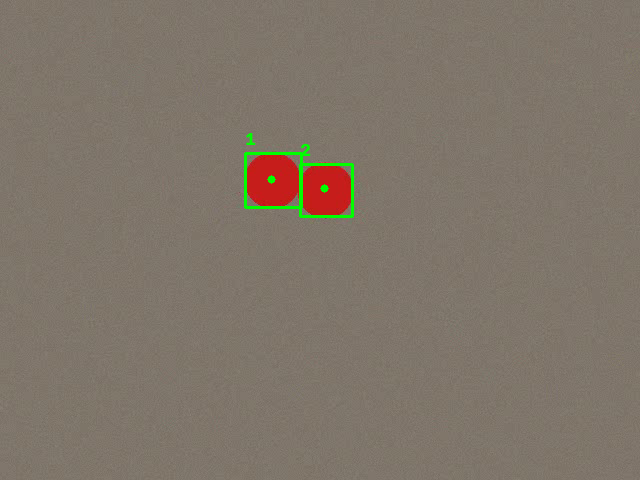 **2 instancias correctas** |
| #28 | Un círculo pasa casi exactamente por delante del otro (solapamiento casi total) | 1 instancia | 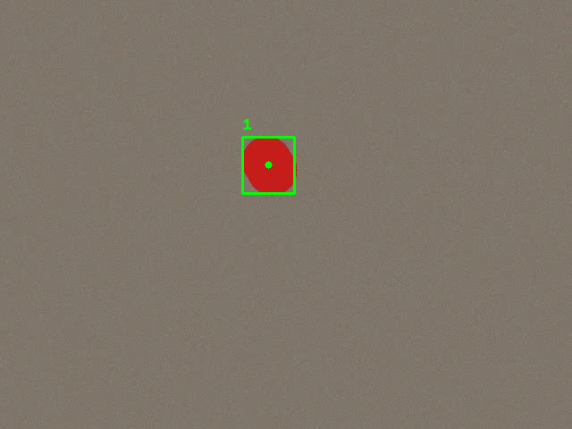 **sigue siendo 1 — no se pudo separar** |

**Por qué el cuadro #28 no se pudo arreglar, y por qué eso es correcto (no un bug):** cuando un objeto está casi exactamente delante del otro, la silueta 2D que ve la cámara es prácticamente idéntica a la de un solo círculo — no hay "valle" en la distancia al borde porque, geométricamente, no hay información suficiente en una sola imagen para saber que son dos. Esto es una oclusión real, no un problema de la máscara, y es justamente el caso para el que existe `track_kalman.py`: en vez de intentar separar el blob en ese cuadro, el filtro de Kalman sigue prediciendo la posición del tomate tapado usando su velocidad, y cuando vuelve a verse por separado unos cuadros después, lo reconecta con su ID (ver `docs/adaptacion.md`, fila de `track_kalman.py`).

**Ajuste del parámetro `ajuste_pico`:** se probó con 0.3, 0.35, 0.4, 0.45 y 0.5 sobre el mismo video — 0.4 fue el valor donde el "cuello" entre los dos círculos recién tocándose queda por debajo del umbral (se separan) sin cortar de más un tomate sano. Valores más bajos (0.3-0.35) no alcanzaban a separar el cuadro #25; no se necesitó ir más arriba de 0.4 para este caso. Si en video real los tomates son de tamaño más variable que estos círculos sintéticos, puede que haga falta volver a ajustar este valor.
